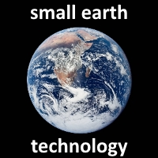

    
     
    <em>Whitespace is the programmers punctuation mark</em>

# Welcome to the MauiTailscaleGrpc Solution

This solution is an evolution of my ANT+ Class Libraries project. Whimsically, it grew out of my
desire to show my friends at the local watering hole what I was working on. I wanted to pull out my
phone, launch my fancy MAUI app, connect to my computer at home, interact with the ANT sensors I was
simulating on my home computer, and savor a sip of bourbon!

## Tailscale as my Networking Solution

I was looking at various homelab setups and VPNs and came across Tailscale. Tailscale checked all my
boxes - free with a decent feature set, simple setup/administration, and secure. I didn't want to open
the gates to just any hacker or script kiddie.

I set up Tailscale on my home computer and my phone, and I was able to connect to my home network, aka
tailnet. This allowed me to connect to the gRPC server running on my home computer from my phone, and I could interact with the ANT+ sensors I was simulating.

Then the bane of any developer's existence struck - <b>scope creep</b>.
What I wanted to do was expose a service on my tailnet that clients could connect to. This would allow me to define the server as a Tailscale service, and I could connect to it from my phone without the client specifying the machine the server was running on. This would allow me to run the server on any machine in my tailnet, and the client would still be able to connect to it.

Secondly, I wanted a logging dashboard to monitor the client/server interactions. My libraries and the application use structured logging, so Serilog with Seq was the obvious choice. I wanted to run Seq in a docker container, and I wanted to expose it as a Tailscale service as well.

## Docker to the Rescue

Tailscale services require a tag-based identity for the host machine. I didn't want to use a tag for my home computer, so I created a docker container that runs the Tailscale service and connects to my tailnet. This allows the gRPC server to communicate with the MAUI client application over the Tailscale service.

The `DockerTailscale/docker-compose.yml` file defines two services: a Tailscale container that provides the tagged tailnet identity and serves the configured Tailscale services, and a Seq container that provides the structured logging dashboard. Seq depends on the Tailscale container’s health status and persists its data locally. Both services restart automatically and have resource limits and health checks configured.

The `DockerTailscale/.env` file contains environment variables for the Docker containers. I use this file to store sensitive information such as the Tailscale authentication key and Seq admin password. The `.env` file is not included in the repository for security reasons, so you will need to create your own `.env` file with the appropriate values. 'DockerTailscale/.env.example' is provided as a template for creating your own `.env` file.

The `DockerTailscale/serve-config.json` file configures the Tailscale service and its reverse proxies. HTTPS traffic on port 443 is forwarded to the local gRPC server at `host.docker.internal:5073`, while HTTP traffic on ports 80 and 5341 is forwarded to the Seq logging service.

The Seq logging dashboard is accessible at `http://localhost:5341` or `http://<tailscale-service-name>:5341` from any device connected to the tailnet.

## AntGrpc.Shared Project

gRPC is a modern, high-performance framework for remote procedure calls. It uses HTTP/2 for transport,
and Protocol Buffers as the interface description language. gRPC is well-suited for connecting and
communicating between distributed systems.

The AntGrpc.Shared project contains the Protocol Buffer definitions. The project is configured to generate client only code for the MAUI client application and it's linked as a project reference in the AntPlusMauiClient project.

The server-side code is generated in the AntPlusServer project. The Protocol Buffer definitions are copied to the AntPlusServer project.

## ANT+ Server Project

The AntPlusServer project is an ASP.NET console application that hosts the gRPC server. It listens for incoming
connections from clients and handles requests to interact with ANT+ sensors. One of the primary NuGet packages
used by the server is the Small Earth Technology ANT USB Stick package. It handles the low-level interaction
with the ANT USB-m stick. Note that the server is configured for the Windows platform, x86, as the ANT USB-m
stick is only supported on Windows.

It runs on my home computer, which is connected to the ANT+ sensors via two ANT USB-m sticks. One stick
serves as a simulator for various ANT+ sensors, while the other stick is used by the gRPC server to interact
with the simulated sensors. I use SimulANT+ to simulate the ANT+ sensors.

## ANT+ MAUI Client Application

The AntPlusMauiClient project is a cross-platform mobile application built with .NET MAUI. It serves as the
client that connects to the gRPC server hosted by the AntPlusServer project. The MAUI app provides a
user-friendly interface to interact with ANT+ sensors remotely. One of the primary NuGet packages used in this
application is the Small Earth Technology ANT+ Class Libraries hosting extension, which provides the necessary
functionality to communicate with ANT+ devices.

### Client App Configuration

The MAUI client application is configured to connect to the gRPC server using the Tailscale service name. This allows the app to communicate securely with the server over the Tailscale network, without needing to expose any ports or configure firewalls. The application can also be configured to connect to the server using its machine name and port, but using the Tailscale service name is more convenient. The localhost configuration is also available for testing purposes when running the server and client on the same machine.

Build->Configuration->AntPlusMauiClient options allow you to select machine, tailscale service, or localhost configuration. The debug and release project configruations will use localhost.

## Supporting Documents

- [Small Earth Technology ANT+ Class Libraries](https://stephenhidem.github.io/AntPlus): Small Earth Technology ANT+ Libraries docs.
- [Software Tools - THIS IS ANT](https://www.thisisant.com/developer/resources/software-tools/): Tools available from Garmin/Dynastream.
- [Tailscale Documentation](https://tailscale.com/docs/): Official Tailscale documentation and guides.
- [Docker Documentation](https://docs.docker.com/): Official Docker documentation and resources.
- [gRPC Documentation](https://grpc.io/docs/): Official gRPC documentation and resources.
- [.NET MAUI Documentation](https://learn.microsoft.com/en-us/dotnet/maui/): Official .NET MAUI documentation and tutorials.
- [.NET MAUI Community Toolkit](https://learn.microsoft.com/en-us/dotnet/communitytoolkit/maui/): Community toolkit for .NET MAUI applications.
- [.NET MVVM Toolkit](https://learn.microsoft.com/en-us/dotnet/communitytoolkit/mvvm/): MVVM toolkit for building maintainable applications.